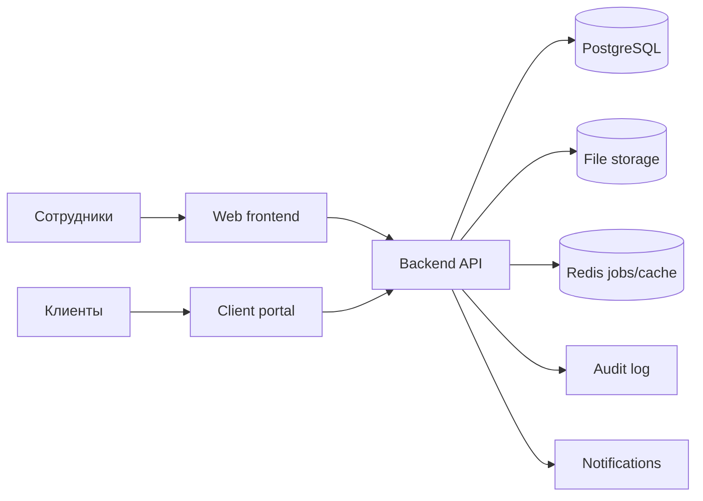

# CtandART ERP - архитектура web-сервиса

## Цель

Создать web ERP для рекламно-производственной компании CtandART: CRM, заказы, производство, склад, магазин, бонусы клиентов, геймификация сотрудников, управленческие финансы, зарплатные начисления, отчеты, аудит и роли.

Бухгалтерия не входит в контур первой системы. Интеграция/экспорт для бухгалтерии возможны позже.

## Высокоуровневая схема



## Стек

### Backend

- Python + FastAPI.
- PostgreSQL как основная база.
- SQLAlchemy ORM.
- Alembic для миграций.
- Pydantic для DTO/валидации.
- JWT/session auth.
- RBAC/ABAC права.
- Audit middleware/service.

### Frontend

- Vite + React + TypeScript.
- SPA-интерфейс для внутренней ERP.
- Отдельные зоны интерфейса:
  - dashboard руководителя;
  - CRM;
  - заказы;
  - производство;
  - склад;
  - магазин;
  - бонусы;
  - геймификация;
  - отчеты;
  - настройки.

### Infra

- Docker Compose для локальной разработки.
- PostgreSQL.
- Redis.
- Позже: reverse proxy, HTTPS, backups, monitoring.

## Модульная структура backend

```text
apps/api/app
  api/v1/routes       HTTP endpoints
  core                config, security, permissions
  db                  database session/base
  models              SQLAlchemy domain models
  schemas             Pydantic request/response schemas
  services            business logic
```

## Главные доменные модули

1. Identity & Access
   - пользователи;
   - роли;
   - права;
   - подразделения/зоны доступа.

2. CRM
   - клиенты;
   - контакты;
   - история заказов;
   - задолженности;
   - бонусный баланс.

3. Orders
   - заказы;
   - позиции заказа;
   - статусы;
   - файлы;
   - комментарии;
   - согласование макетов.

4. Production
   - задачи дизайнеров;
   - задачи печати/производства;
   - монтаж;
   - брак/переделки;
   - фактическое время.

5. Inventory
   - главный склад;
   - производство/офис;
   - магазин;
   - приход;
   - перемещение;
   - резерв;
   - списание;
   - ревизия.

6. Store
   - розничные продажи;
   - касса магазина;
   - возвраты.

7. Payments & Management Finance
   - оплаты;
   - кассы;
   - долги;
   - возвраты;
   - дневное закрытие.

8. Loyalty
   - уровни клиентов;
   - бонусы;
   - бонусный аванс;
   - списание бонусов.

9. Gamification
   - рейтинг сотрудников;
   - баллы;
   - команды;
   - месячный leaderboard.

10. Payroll
    - правила начислений;
    - бонусы сотрудников;
    - расчетный лист.

11. Reports
    - дневной отчет;
    - отчеты по складу;
    - отчеты по сотрудникам;
    - отчеты по заказам.

12. Audit
    - журнал действий;
    - подозрительные операции;
    - неизменяемые записи.

## Безопасность

- Все критические операции проходят через backend, frontend ничего не решает сам.
- Пароли хранятся только в виде хэша.
- Роли определяют доступ к модулям.
- Складская зона определяет видимость остатков.
- Себестоимость, закупочные цены, маржа, зарплаты скрыты от обычных ролей.
- Критические операции нельзя удалить, только отменить обратной операцией.
- Ведение audit log обязательно.
- Для руководителя/админа желательно включить 2FA.

## Управляемость

- Все справочники настраиваются из админки:
  - роли;
  - статусы заказов;
  - склады/зоны;
  - кассы;
  - бонусные уровни;
  - правила начислений;
  - типы задач;
  - причины списаний/возвратов.

## MVP

Первая рабочая версия должна включать:

1. Авторизацию и роли.
2. CRM клиентов.
3. Заказы и позиции заказа.
4. Производственные задачи.
5. Три учетные складские зоны.
6. Складские движения с аудитом.
7. Оплаты и долги.
8. Бонусный баланс клиентов.
9. Дневной отчет руководителя.
10. Базовый dashboard.
