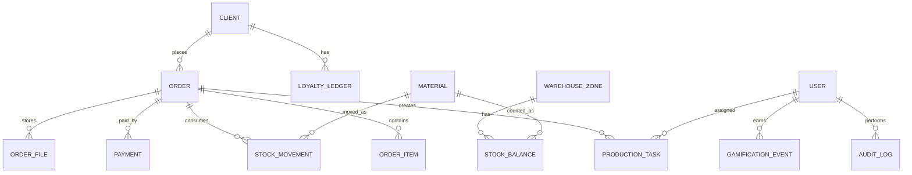

# CtandART ERP - доменная модель

## Главная идея

Заказ клиента - центральная сущность. Все вокруг заказа:

- клиент;
- позиции заказа;
- дизайн/макеты;
- производственные задачи;
- материалы;
- списания;
- оплаты;
- бонусы;
- документы;
- аудит;
- итоговая маржа;
- вклад сотрудников.

## Сущности

## Роли

- OWNER: руководитель/учредитель.
- ADMIN: администратор системы.
- WAREHOUSE_MANAGER: завсклад.
- MANAGER: менеджер.
- DESIGNER: дизайнер.
- PRODUCTION: печатник/производство.
- INSTALLER: монтажник.
- STORE_CASHIER: магазин/кассир.
- FINANCE: финансист/управленческий учет.
- CLIENT: клиентский кабинет.

## Складские зоны

- MAIN: главный склад.
- PRODUCTION: производство/офис.
- STORE: магазин.

## Типы складских движений

- RECEIPT: приход на главный склад.
- TRANSFER: перемещение между зонами.
- RESERVE: резерв под заказ.
- RELEASE_RESERVE: снятие резерва.
- ISSUE_TO_ORDER: списание на заказ.
- RETURN: возврат.
- WASTE: списание брака/порчи.
- INVENTORY_ADJUSTMENT: корректировка по ревизии.

## Типы подозрительных операций

- Ручная скидка.
- Изменение цены после создания.
- Отмена оплаты.
- Списание без заказа.
- Сверхнормативное списание.
- Бонусный аванс.
- Ручная корректировка бонусов.
- Корректировка склада.
- Возврат денег.
